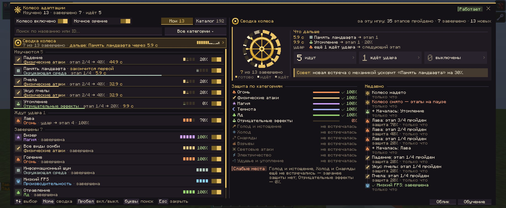
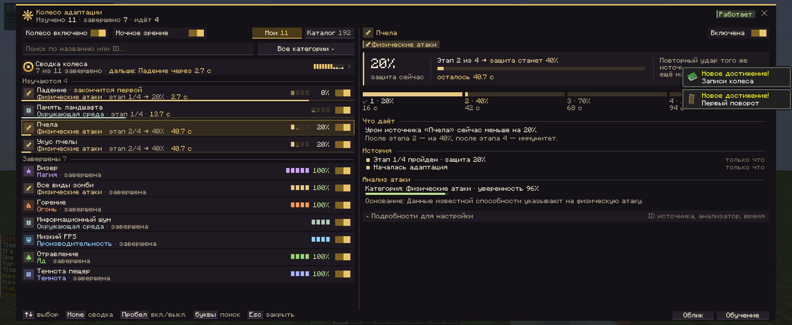
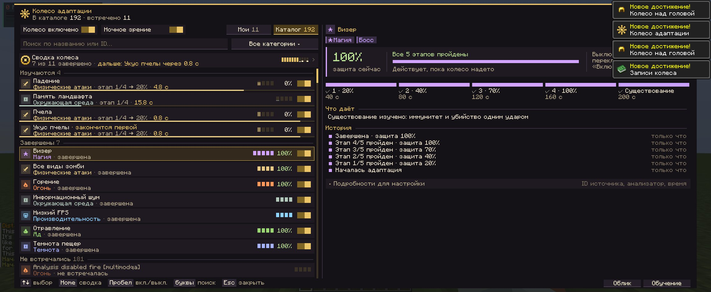
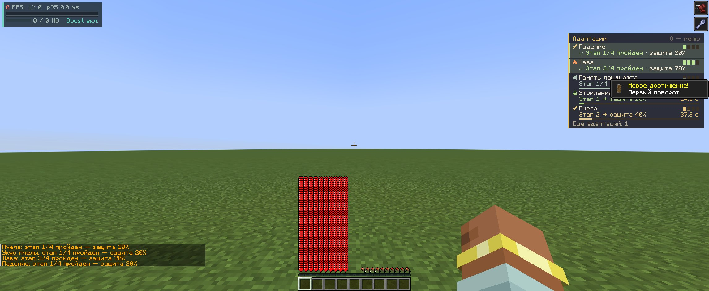
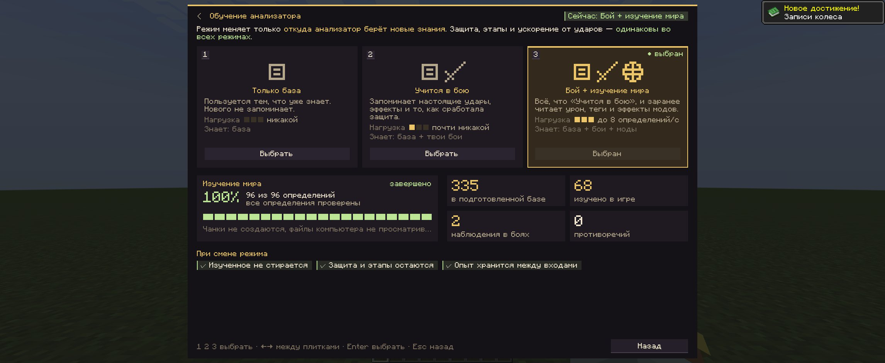
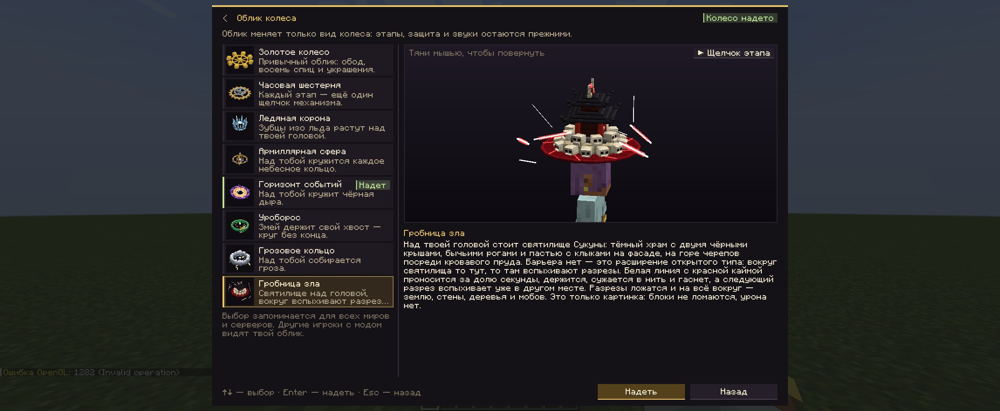
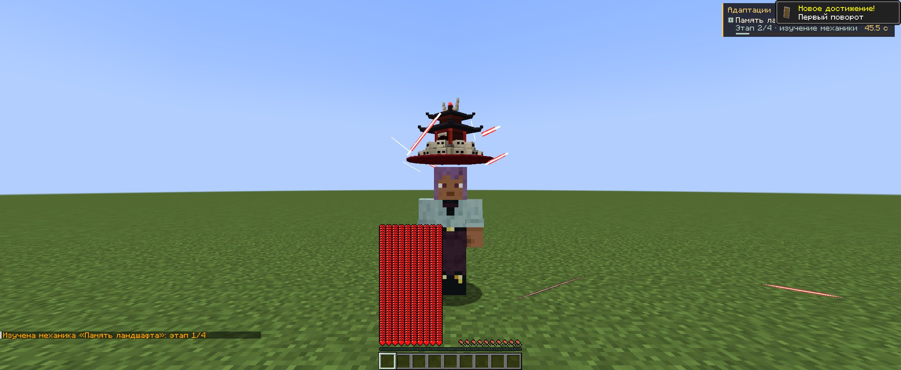
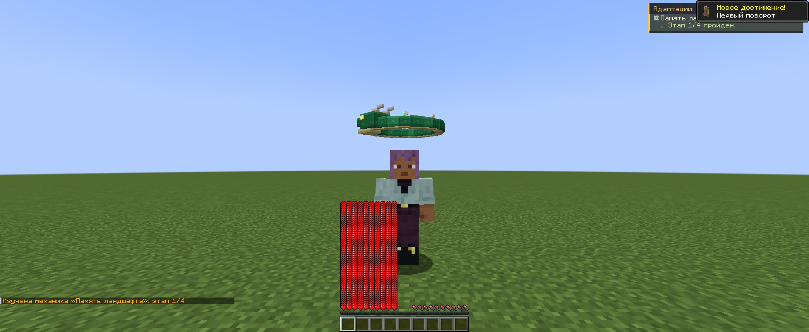
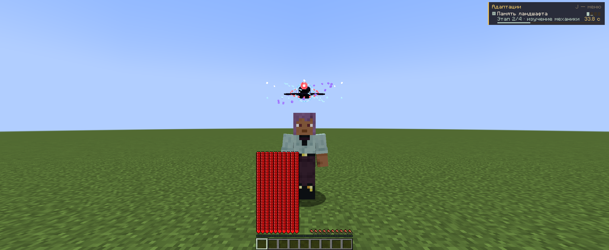

# Adaptation Wheel

**A head-slot artifact for Minecraft 1.20.1 (Forge) that learns to protect you from whatever hurts you.**

[Русская версия](README.ru.md) · [Changelog (RU)](CHANGELOG.md) · [Releases](https://github.com/pashapasha94237-stack/adaptation-wheel/releases) · [Report a bug](https://github.com/pashapasha94237-stack/adaptation-wheel/issues)

    



Every damage source, mob species, harmful effect and condition, from vanilla or from any mod, gets its own adaptation. Four stages take it from **20 % to 100 % protection**; every repeat hit speeds the current stage up; bosses get a fifth stage that ends in immunity and a one-hit kill. A local analyzer (no internet, no language model) classifies attacks from any mod. The wheel also learns 44 non-combat annoyances, unlocks an embedded FPS optimizer and comes with the Sword of Extermination and nine looks.

The mod ships as **one jar**: the wheel, the sword, and **Adapt Boost 1.7.0** (optimizer) are all inside. Distant Horizons is no longer bundled (since 4.49.0); you can still install it as a separate mod, but the wheel does not use it.

## Contents

- [Screenshots](#screenshots)
- [Features](#features)
- [Installation](#installation)
- [Configuration](#configuration)
- [Building from source](#building-from-source)
- [Tests and QA](#tests-and-qa)
- [Project layout](#project-layout)
- [Known limitations](#known-limitations)
- [Licence and credits](#licence-and-credits)

## Screenshots

| | |
| --- | --- |
|  Details: protection now, stage track, what it gives, history, analyzer verdict |  A boss after stage V: immunity and a one-hit kill |
|  HUD under the effect icons; a finished stage lights up |  Learning screen: three modes, world study, knowledge counters |
|  Looks screen with a live preview on your character |  «Malevolent Shrine» look: blades flash around the wearer |
|  «Ouroboros» look |  «Infinite Void» look: black core, star dust |

## Features

### The wheel

- **Craft:** 8 gold ingots around an ender pearl (`/give @s adaptationwheel:wheel`). Right-click wears it in the head slot; the previous helmet goes to your hand. No durability, no armour points.
- **Adaptation starts with the first hit you survive.** Stages **I–IV** give **20 → 40 → 70 → 100 %** protection against that source. Stage time depends on the category (fire 8/20/32/44 s, physical and projectiles 20/50/80/110 s, magic and bosses 40/80/120/160 s, see the table below). The end of a stage: a sound, one 45° turn of the wheel, a full heal (can be turned off).
- **Repeat hits accelerate.** Each hit of the same source during a stage adds +30 % to the countdown speed (×1.30, ×1.60, ×1.90…). The menu and HUD show time in «seconds of adaptation at ×1» plus a gold speed chip; a hit flashes «+30% speed». **Element experience:** every mastered source of a category makes new sources of that category start 5 % faster, up to +35 %.
- **Independent scales.** Every mob species, damage type, effect and condition has its own entry; vanilla zombie variants are folded into one. The strongest applicable protection is used; percentages do not add up.
- **Stage V — Adaptation to Existence.** Only against mobs with **100 HP or more** (Warden, Ender Dragon, Wither, modded bosses). After stage IV the wheel spins without stopping for 200 s (blocked hits of that boss speed it up); then you are immune to it and kill it in one hit, even with a bare fist. Both switches are configurable. Commands never grant stage V.
- **Pause rules.** Taking the wheel off, the global switch or a disabled entry pauses progress and protection. Death keeps the earned stages and resets the running stage.

| Category | I | II | III | IV |
| --- | --- | --- | --- | --- |
| Fire | 8 s | 20 s | 32 s | 44 s |
| Physical attacks, projectiles | 20 s | 50 s | 80 s | 110 s |
| Explosions, electricity | 25 s | 55 s | 85 s | 115 s |
| Light attacks | 32 s | 67 s | 102 s | 137 s |
| Magic and bosses | 40 s | 80 s | 120 s | 160 s |
| Negative effects, poison, suffocation | 12 s | 30 s | 48 s | 66 s |
| Hunger, cold, darkness, environment | 10 s | 25 s | 40 s | 55 s |

### Darkness, hunger, cold and effects

- **Negative effects** (every HARMFUL effect, modded ones included): a new application is shortened by 20/40/70 % per stage and blocked at 100 %.
- **Hunger:** rotten flesh, low food and starvation are one adaptation; at 100 % food and saturation stay at 20, so you can sprint and regenerate without eating.
- **Cold:** starts with freezing; at 100 % freezing damage is blocked.
- **Darkness:** learned in a dark cave. Stages give real light around you (5 → 10 → 15) and stage IV adds **infinite night vision** with its own toggle in the menu.

### Local analyzer and learning

- **14 categories** (fire, physical, projectile, explosion, magic, effect, hunger, cold, darkness, environment, light, electric, poison, suffocation), each with its own stage times.
- **Evidence order:** datapack tags `adaptationwheel:adaptation/<category>` → vanilla damage-type tags and known vanilla types → observed delivery and attributed elements → compatibility tables (428 damage types from a 616-mod corpus, 13 tags) → the type's own mod tags → attributed effects → name vocabulary → harmful effect → fallback. Every verdict carries a confidence value and a reason shown in the menu.
- **Three learning modes** (Ctrl+L): *Base only*; *Learns in combat* (remembers real hits, effects and how protection worked); *Combat + world study* (reads the damage types and effects of installed mods ahead of time, 8 definitions/s by default, never generates chunks and never grants stages). Memory lives in player NBT and in `adaptationwheel/learning/<trained|untrained>/<UUID>.json`.
- **Learned patterns:** three agreeing known abilities can cautiously refine a new weak category; contradictions abstain; guesses never train themselves; stages and immunity never transfer.
- **Manual fix:** press **K** in the details to correct a category (or take the correction back). Only the name and the stage times of that row change; the analyzer keeps collecting data.
- **`/adaptation why <adaptation>`** explains category, confidence, reason, facts, danger pace, what a mob mainly hits with, and element experience.
- **Two builds:** `trained` ships 506 reviewed hints for modded mobs and attacks; `untrained` starts from the game's data alone.

### The J menu and HUD

- **J** (rebindable; also `/adaptation menu` or Shift + right-click with the wheel in hand). The menu does not pause the game.
- Opens on the **Wheel Summary**: a ring of marks, «What's next», counters (running / waiting for a hit / disabled), a tip, protection per category with weak spots, and a session journal.
- **Tabs «Mine» and «Catalogue»** with counts, search by name or id, a category filter, grouped rows (Learning / Waiting for a hit / Done / Disabled / Not met), per-row switches.
- **Details:** a «Now» card (protection, stage → target, bar, time and speed or the pause reason), «What it gives», analysis with the confidence bar, «Where the knowledge comes from», history, a folded settings block with the source id for Configured.
- **Keyboard:** arrows, Enter, Space, Home, Ctrl+F, type-to-search, Esc; K (category fix), Ctrl+L (learning), Ctrl+K (looks).
- **Layouts:** list and details side by side on wide GUIs, a compact header on short ones; unit-tested over every GUI size.
- **HUD** under the effect icons: running adaptations with stage, target protection, time and speed; a finished stage lights up; «N more» when space runs out.
- **Tooltips:** the wheel shows what it does, your counts and the bound key; the sword shows its multipliers and Shift details.

### Sword of Extermination

- Craft: quartz block, string, end rod, netherite ingot (pattern ` Q ` / `SQS` / `ENE`). 10 damage, **×2 to undead, ×4 to mobs you choose** (each can have its own multiplier in Configured). Worn on the forearm in first person.
- **Parry:** hold right-click to deflect melee strikes and projectiles of an attacker you have adapted to from stage I (the wheel must be worn).
- **World Slash** (Shift + right-click switches the mode): unlocked by stage V of any boss. A 64-block-long, 20-block-wide diagonal plane through walls deals exactly **300 HP (150 hearts)** to every target through armour, resistance and absorption, cuts blocks (configurable), costs 3 durability, 45 s cooldown. It pierces Jujutsu Craft's Infinity.

### Low FPS → Adapt Boost

When your FPS stays between 1 and 59, the «Low FPS» adaptation runs. Stage IV unlocks the embedded **Adapt Boost 1.7.0** optimizer (mod ID `pashaboost`): **F8** opens its screen, **F9** runs an A/B measurement, **F10** toggles it. It contains, among other things: a FerriteCore-based memory port, direct glyph lookup, sign text culling, sampler-name and vertex-element caches, entity data lock elision, particle light sharing, primitive-array quad sorting, same-value XP orb merging, a frame cap while the window is unfocused, distant-mob culling and version-gated fixes for hotspots in Alex's Mobs, Twilight Forest, BrandonsCore and Mahou Tsukai. Every feature has a JVM opt-out (`-Dpashaboost.disable*`) and the mixin plugin stands down next to mods that replace the same thing (Embeddium, Sodium-based mods, ModernFix, Clumps, FerriteCore, Lithium, Oculus…). Tested with and without OptiFine; on a dedicated server it does nothing.

### 44 non-combat adaptations

All in the «Environment» category, each with its own switch in the menu and in Configured; a refusal by the game (a bed, an anvil, a bow without arrows…) starts or speeds up the stage.

**Seven world mechanics**

| Adaptation | Starts when | Stage IV |
| --- | --- | --- |
| World border | you reach the border | walk up to 64 blocks past it (personal) |
| Notification noise | repeated safe notifications | exact repeats are grouped |
| Inventory pressure | 33 of 36 slots full | **unlimited stacks** in your own inventory (up to 1 000 000 000 per slot) |
| Silent world | volume at 0 while a sound happens nearby | direction, caption, height of the source |
| Memory pressure | 10 s of high heap load | render distance drops by 2 chunks at a time (not below 6) while memory is short and returns after 30 calm seconds; garbage collection is never forced |
| Low server TPS | 10 s of slow ticks | the wheel's own saves and packets are batched |
| Memory of defeat | death after a fight | ghost trail of the last defeats and a warning at a familiar combo |

**Eleven events outside the world:** foreign mods (a changed mod list is named, with what each new mod brought), log errors (identical errors are trimmed at stage IV, fatal ones never), renamed world, config editing (old → new values), system clock change (timers ignore it), crash memory (30 s of protection after rejoining a crashed world), idle/AFK (mobs lose you after a minute idle), inventory in combat (halved damage, then 20 s of safety after opening), network loss, wheel update (what changed), console commands (`/kill` against you is refused). **Near misses:** miss a mob by less than two blocks and, at stage IV, arrows, bolts and supported gun bullets are guided to a target within 64 blocks (native damage and collisions stay).

**23 everyday adaptations** (4.29): daytime sleep (sleep by day, fast-forward to evening, sneak-click for morning), sleeping near monsters, insomnia (phantoms later, then never), bed in a foreign dimension (no explosion, then a personal spawn point), sticky blocks (cobweb, powder snow, berries, soul sand, honey), waiting in a portal (down to one tick), mining in mid-air or under water, trampled farmland, waiting at the furnace (×1.25 … ×3 within 8 blocks), water in the Nether (3 s … forever), broken tool (warning, then restored to 25 %, 50 %, fully), «Too expensive!» (limit 50, 60, none), empty quiver (counts arrows, then shoots without arrows for durability), item cooldown (−15 … −50 %), enderman gaze, creeper-wrecked buildings (25 … 100 % of blocks survive), piglin gold, villager trading (demand surcharge gone, restock once a minute), surrounded (melee hits splash to mobs targeting you), murky water, sight through lava, unseen foes (invisible mobs outlined), laptop battery (FPS and render distance lowered while on battery, restored safely even after a crash).

**Two travel adaptations** (4.30): Torrent (riptide out of water, 75 % power on land) and Shattered Eye (distance to the stronghold, then an unbreakable Eye of Ender that returns to your hand).

Details of every one: [UTILITY-MECHANICS.md](UTILITY-MECHANICS.md) (RU).

### Wheel looks

Ctrl+K or the «Look» button: **Golden Wheel** (default), **Clockwork Gear**, **Ice Crown**, **Armillary Sphere** (every ring turns), **Event Horizon**, **Ouroboros**, **Storm Ring**, **Malevolent Shrine** (blades flash around you in waves and cut the scenery and nearby mobs; purely visual, can be switched off) and **Infinite Void** (its name and description are unreadable noise until a 20 s «adapt to the text» stage; an information stream rises over mobs within 10 blocks, star dust falls into the core). The screen shows a live preview on your own character. A look is purely visual, stored in the client config, and other players with the mod see it. Looks are box models in `src/main/resources/wheel_skins/*.json`, drawn through one rig; checked with 17 shader packs.

### Advancements, commands, integration

- **8 advancements** in their own tab: Adaptation Wheel, Wheel Above Your Head, First Turn, Won't Work Again (stage IV), Adaptation to Existence, The Wheel's Records (menu), Sword of Extermination, World Slash. Earlier progress is credited silently at login.
- **`/adaptation`:** `on`, `off`, `status`, `reset`, `list [page]`, `info <adaptation>`, `why <adaptation>`, `enable|disable <adaptation>` for yourself; operators also get `learn <players> <0–4> <adaptation>`, `forget`, `on|off|reset <players>`, `status <player>`, `list <player>`. Tab completion asks the server.
- **Configured** (2.2.3 tested) edits every setting in game; the look screen and the learning screen are reachable from it too.
- **Languages:** English and Russian (about 2,400 strings each).

### Mod compatibility

Any mod's damage types, mobs and effects are picked up through Forge events and registries. On top of that: Jujutsu Craft v51 (techniques, Infinity), Try 2 Survive (diseases), Ice and Fire, Advent of Ascension 3, Twilight Forest, First Aid (body-model health), Alex's Caves, Tough As Nails (thirst), SanityDim, Mekanism (radiation), NuclearCraft, Dragon Survival, Mana and Artifice, Blood Magic and Simply Swords (voluntary HP costs stay native), Supplementaries and Curios (quivers), Sophisticated Backpacks (anvil tab), MrCrayfish's Guns and Scorched Guns (guided bullets). An `AutonomousHealthGuard` covers mods that write health directly instead of dealing damage. Releases are checked in a real client with a 24-mod test pack and with the author's 87-mod pack (with OptiFine HD U I6_pre6); each `VALIDATION-<version>.md` says what was run for that version.

Datapack and mod authors can set an exact category for an opaque damage type without Java:

```json
// data/adaptationwheel/tags/damage_type/adaptation/light.json
{ "replace": false, "values": ["examplemod:opaque_attack"] }
```

Tag names: `fire`, `physical`, `magic`, `effect`, `hunger`, `cold`, `darkness`, `environment`, `projectile`, `explosion`, `light`, `electric`, `poison`, `suffocation`.

## Installation

**Requirements:** Minecraft Java **1.20.1**, **Forge 47.4.0 or newer**, **Java 17**.

1. Download **one** jar from [Releases](https://github.com/pashapasha94237-stack/adaptation-wheel/releases/latest):

   | File | What it is |
   | --- | --- |
   | `adaptation-wheel-1.20.1-4.49.0-trained.jar` | **Recommended.** Prepared knowledge base (506 hints) for modded mobs and attacks. |
   | `adaptation-wheel-1.20.1-4.49.0-untrained.jar` | The same mod without the starting base. |
   | `…-trained-online.jar`, `…-untrained-online.jar` | Plus an experimental advisor that can call an external OpenAI-compatible API (off until you configure an endpoint and an API key in an environment variable; falls back to the local analyzer on any error). |

2. Put it into `mods`. Remove any older wheel jar: every variant shares the mod ID `adaptationwheel`.
3. Do **not** install a second copy of Adapt Boost; it is inside. Configured is optional. Distant Horizons is not needed; it can be installed separately and runs on its own (once Adapt Boost is active, its optional lightmap optimisation for Distant Horizons applies too).
4. **Servers:** the same jar on the server and on every client; versions must match (network protocol 23 in 4.49.0, so 4.48.x and 4.49.0 do not connect to each other).
5. **OptiFine:** works with 1.20.1 HD U I6_pre6.
6. **Updating from 4.48.x:** saved «Landscape memory» progress is dropped when you join a world. Terrain that Distant Horizons already recorded (`DistantHorizons.sqlite` files) stays on disk; delete it by hand if you do not need it.

Checksums of every file are in `VALIDATION-4.49.0.md` and next to the release assets.

## Configuration

| File | What it holds |
| --- | --- |
| `saves/<world>/serverconfig/adaptationwheel-server.toml` | stage times per category and per mob, `sourceOverrides` rules, protection per stage, healing, existence stage, sword, analyzer |
| `…/adaptationwheel-utility-server.toml` | switches and numbers of the non-combat adaptations, aim settings |
| `…/adaptationwheel-learning-server.toml` | learning mode, definitions per second |
| `config/adaptationwheel-fps-client.toml` | «Low FPS» progress |
| `config/adaptationwheel-utility-client.toml` | memory threshold, defeat trail |
| `config/adaptationwheel-appearance-client.toml` | wheel look, Shrine cuts, Void effects |
| `config/pashaboost-client.toml`, `config/pashaboost-common.toml` | Adapt Boost (also the F8 screen) |
| `config/adaptationwheel-neural-common.toml` | `-online` variants only: endpoint, model, name of the key environment variable |

Source-specific times: `sourceOverrides = ["mob:examplemod:creature=5,10,15,20,25"]` (five stage times in seconds, `0` inherits the category). On a server the administrator's settings apply to everyone.

## Building from source

Requires JDK 17; the Gradle wrapper is included (ForgeGradle 6, Forge 1.20.1-47.4.0).

```powershell
.\gradlew.bat build                 # one jar in build/libs, unit tests included
.\gradlew.bat build -PpretrainedKnowledge=false    # untrained variant
.\gradlew.bat build -PneuralOnline=true            # online variant
```

The embedded `embedded/adapt-boost-1.20.1-forge-1.7.0.jar` is copied into the jar as is (its sources are in `embedded-src/`). `release-4.49.0.ps1` builds all four variants with clean builds, checks that the embedded jar stayed byte-identical and writes jars, a sources zip and `SHA256SUMS` into `dist/`.

GameTests run separately and without the embedded jars:

```powershell
Remove-Item build\resources\main\META-INF\jarjar\*.jar -ErrorAction SilentlyContinue
.\gradlew.bat runGameTestServer
.\gradlew.bat build        # a jar built in the same invocation as the GameTest server lacks the embedded mods
```

The author builds offline with a local JDK in `.tools/` and a Gradle cache in `.gradle-user-home` (`build-mod.ps1`); a normal online Gradle build works the same way.

## Tests and QA

- **Unit tests** of the pure core (`src/test`, task `coreTest`, part of `check`): state machine, analyzer rules, layouts over every GUI size, skin rig, summary raster, void text and more.
- **192 Forge GameTests** (`src/gametest`): real server players, hits, effects, commands, advancements, utility adaptations, World Slash damage, network packets.
- **Real-client probe runs** (`compat-tests/`, a Forge test mod that scripts the client, takes screenshots and checks the synced state) with and without OptiFine and in multi-mod packs. The other mods' jars are local inputs and are not part of the repository.
- Every release has a `VALIDATION-<version>.md` with what was run and what was not.

## Project layout

```
src/main/java/ru/pasha/adaptationwheel/
  core/       pure logic, no Minecraft classes (unit-tested)
  server/     events, analyzer, adaptations, commands, compatibility
  client/     menu, HUD, looks, world effects
  net/        packets and synced state
  item/       the wheel and the sword
src/main/resources/
  coremods/   load-time patches (JavaScript coremods)
  compat/     compatibility tables
  wheel_skins/ box models of the nine looks
  knowledge/  prepared knowledge base (trained build)
  data/, assets/  tags, advancements, recipes, textures, sounds, lang
src/test, src/gametest   unit tests and GameTests
embedded/, embedded-src/ bundled Adapt Boost with its sources
compat-tests/            real-client QA harness and audits
forge-1.16.5/            the old 4.0.0 port for Minecraft 1.16.5 (basic wheel only)
docs/                    screenshots and publishing texts
CHANGELOG.md, VALIDATION-*.md, *-ANALYZER.md, UTILITY-MECHANICS.md   history and design notes (RU)
```

## Known limitations

- Forge 1.20.1 only; no Fabric or NeoForge build. The 1.16.5 folder is an old minimal port.
- The analyzer is a rule system with heuristics: a mod that bypasses Forge damage and effect events and writes its own private state may need a dedicated bridge. Positive effects declared HARMFUL by their author are treated as harmful.
- Adapt Boost is client-side; measured gains depend on the scene and the pack.
- The online advisor is experimental and off by default.
- Documentation beyond this README is in Russian.

## Licence and credits

- The wheel's own code, data, models and texts: **MIT** ([LICENSE](LICENSE)).
- **Adapt Boost 1.7.0:** MIT, with two ModernFix-derived classes under LGPL-3.0-or-later and FerriteCore-derived code under MIT; ideas credited to particle_core, Clumps, Dynamic FPS, ImmediatelyFast, Embeddium, Sodium, Lithium and MoreCulling.
- Full notices, hashes and source pins: [THIRD-PARTY.md](THIRD-PARTY.md).
- The looks «Malevolent Shrine» and «Infinite Void» are original models whose names reference *Jujutsu Kaisen*; no third-party assets are included. Minecraft is a trademark of Mojang/Microsoft; this is an unofficial mod.

**Author:** Pasha.

Bugs and ideas: [GitHub issues](https://github.com/pashapasha94237-stack/adaptation-wheel/issues). Russian is welcome.
