# Колесо адаптации и Меч истребления 4.51.0 — Minecraft 1.20.1 / Forge


**Среда:** клиент и сервер · **Minecraft Java 1.20.1** · **Forge 47.4.0+** · **Java 17**. Для сетевой игры установи одинаковую версию мода на сервер и всем игрокам.

[Проект на CurseForge](https://www.curseforge.com/minecraft/mc-mods/adaptation-wheel) · [Вращение колеса во время «Адаптации к существованию» (4K, 60 FPS)](https://youtu.be/Bv9UM1Yx0hg) · [Годжо — «Безграничная пустота» (4K, 60 FPS)](https://youtu.be/B14F_-cPGTg) · [Сукуна — «Зловещее святилище» (4K, 60 FPS)](https://youtu.be/LTwNyA2Tq_Q)


[English README](README.md) · [История версий](CHANGELOG.md) · [Релизы](https://github.com/pashapasha94237-stack/adaptation-wheel/releases) · [Сообщить об ошибке](https://github.com/pashapasha94237-stack/adaptation-wheel/issues)

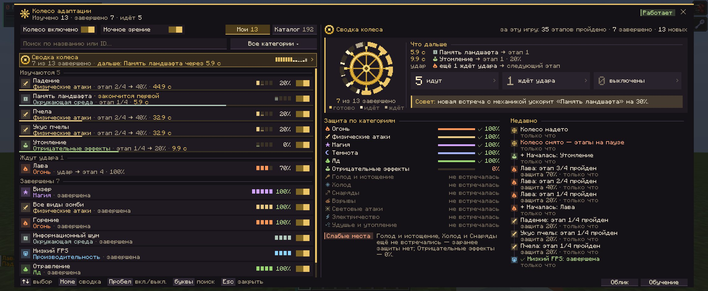

Установи **один** файл: `adaptation-wheel-1.20.1-4.51.0-trained.jar` с подготовленной
базой либо `adaptation-wheel-1.20.1-4.51.0-untrained.jar` без стартовой дополнительной базы.
Оба работают без интернета. Дополнительно выпускаются варианты с суффиксом `-online`
для сохранённого экспериментального советника через API. У них один mod ID:
обе разновидности и прежнюю версию колеса одновременно ставить нельзя.
Нужны Java 17 и Forge 47.4.0+ для Minecraft Java 1.20.1.

Колесо, меч и оптимизация уже внутри одного устанавливаемого JAR. Отдельный Adapt Boost
(раньше Pasha Boost) не нужен. Боевая адаптация, Configured и прежние интеграции сохранены.
FPS-оптимизатор включается только после IV этапа FPS.

## Как играть

### Что делает мод

Колесо адаптации надевается в слот головы и учится защищать от того, что тебя ранит: от вида моба, отдельной
атаки, вредного эффекта, голода, холода и темноты. Каждая адаптация проходит этапы I–IV, и защита растёт до
полной; против мобов со 100 HP и больше есть ещё этап V — «существование». Кроме боя, колесо снимает бытовые
неудобства игры (сон днём, долгая плавка, «Слишком дорого!»), а при низком FPS открывает встроенный оптимизатор
Adapt Boost. Меч истребления — оружие к колесу: усиленный урон по нежити и выбранным мобам, парирование и
Мировой разрез.

### Установка

Нужны Minecraft Java 1.20.1, Forge 47.4.0 или новее и Java 17. Колесо работает и с OptiFine
1.20.1_HD_U_I6_pre6 (версия лаунчера `ForgeOptiFine`). Выбери **один** jar со страницы
[релизов](https://github.com/pashapasha94237-stack/adaptation-wheel/releases/latest) (при сборке из исходников — из папки `dist/`):

| Файл | Что внутри |
| --- | --- |
| `adaptation-wheel-1.20.1-4.51.0-trained.jar` | подготовленная база анализатора: 506 проверенных подсказок категорий; рекомендуемый вариант |
| `adaptation-wheel-1.20.1-4.51.0-untrained.jar` | без стартовой базы: анализатор опирается только на правила игры и опыт боёв |
| `adaptation-wheel-1.20.1-4.51.0-trained-online.jar` | как `trained`, плюс экспериментальный советник через внешний API |
| `adaptation-wheel-1.20.1-4.51.0-untrained-online.jar` | как `untrained`, плюс тот же советник |

- Все четыре работают без интернета. Вариант `-online` обращается к API, только если настроить свой совместимый
  API, модель и ключ в переменной окружения серверного процесса; по умолчанию запросы выключены, а при ошибке
  остаётся локальный анализатор (подробно — `NEURAL-ANALYZER.md`).
- Положи jar в папку `mods` (в стандартном лаунчере это `%APPDATA%\.minecraft\mods`). Прежний jar колеса оттуда
  удали: у всех вариантов и версий один mod ID, поэтому ставится только один файл.
- Adapt Boost 1.7.0 (раньше Pasha Boost) уже внутри jar, отдельно его ставить не нужно.
- С 4.49.0 Distant Horizons в jar не входит, и колесо его не использует. Его можно поставить отдельным модом,
  если он нужен; тогда, когда Adapt Boost включён, снова работает и его необязательная оптимизация для Distant Horizons. Уже записанный
  ландшафт (файлы `DistantHorizons.sqlite`) остаётся на диске — его можно удалить вручную.
- Для сетевой игры тот же jar ставится и на сервер, версия на сервере и у игроков должна совпадать: 4.51.0
  (протокол 24) не соединяется с 4.49.x и более ранними версиями. На выделенном
  сервере оптимизатор не работает: FPS — свойство клиентского компьютера.

### Управление

Меню: **J**, `/adaptation`, `/adaptation menu` или Shift + ПКМ с колесом в руке. Клавишу можно переназначить. Меню не ставит игру на паузу.

| Клавиши | Что делают |
| --- | --- |
| **J** | открыть и закрыть меню адаптации. Переназначается в настройках управления Minecraft: группа «Колесо адаптации», строка «Меню адаптации» |
| ПКМ с колесом в руке | надеть колесо в слот головы, прежний шлем переходит в руку |
| **K** в деталях строки | поправить категорию вручную или вернуть решение анализатора; в окне выбора стрелки, Enter и Esc |
| **Ctrl+L** в меню | экран «Обучение», как кнопка «Обучение» внизу справа |
| **Ctrl+K** в меню | экран «Облик колеса», как кнопка «Облик» рядом с «Обучением»; там ↑↓ — выбор, Enter — надеть, Esc или Backspace — назад |
| Ctrl+F, ↑↓, Enter, Пробел, Esc в меню | поиск, выбор строки, подробности, вкл./выкл. выбранной строки, выход (Esc сначала очищает поиск) |
| удерживать ПКМ с мечом | поднять клинок: парирование ближних ударов и отражение снарядов спереди |
| **Shift + ПКМ** с мечом в основной руке | переключить режим: парирование / Мировой разрез |
| ПКМ в режиме разреза | Мировой разрез по направлению взгляда |
| **F8** | экран встроенного Adapt Boost (настройки оптимизации) |
| F9 / F10 | A/B-замер Adapt Boost / включить или выключить его контроллер |

Парирование и отражение работают с надетым колесом после I этапа адаптации к атакующему. Мировой разрез
открывается после этапа V любого моба со 100 HP и больше: 300 HP (150 сердец) каждой цели сквозь броню,
плоскость 64 блока вперёд и 20 в размахе, откат 45 с. Оптимизации Adapt Boost действуют только после IV этапа
адаптации «Низкий FPS»; до этого F10 напоминает об этом.

### Этапы адаптации

- Первый пережитый урон запускает адаптацию к его источнику. Этапы **I–IV** по умолчанию дают
  **20 → 40 → 70 → 100 %** защиты. Время этапа зависит от категории: от 8 с (огонь, I этап) до 160 с (магия и
  боссы, IV этап), таблица «Время этапов» ниже.
- Повторный удар во время этапа ускоряет отсчёт (по умолчанию на 30 % базовой скорости), а не отнимает время.
- Конец этапа: звук, колесо поворачивается на 45°, полное лечение (его можно выключить в Configured).
- **V — «существование»** — только против мобов с максимальным здоровьем 100 HP и больше. После IV этапа колесо
  вращается без остановки (по умолчанию 200 с, заблокированные удары босса ускоряют этап). Итог — полная защита
  и убийство босса одним ударом, даже кулаком; оба переключателя есть в Configured. Командой этап V не выдаётся.
- Особые адаптации: низкий FPS 1–59 (IV этап включает Adapt Boost), темнота (свет вокруг, на IV — бесконечное
  ночное зрение), вредные эффекты и 39 небоевых адаптаций категории «Окружающая среда» — от границы мира и
  батареи ноутбука до печи и наковальни (подробно — `UTILITY-MECHANICS.md` и [CHANGELOG.md](CHANGELOG.md)).
- При снятом колесе, отключённой системе или отключённой отдельной записи защита не действует, прогресс стоит на паузе. Сохранение включает готовые степени, оставшийся прогресс, ускорение, категорию обнаруженной атаки и настройки. Смерть сохраняет готовые степени и настройки, но сбрасывает текущий этап. Прежние иммунитеты версий 1–4 переносятся.

### Достижения

У колеса своя вкладка достижений: получение колеса, надевание на голову, первая адаптация, первый IV этап, V этап
(существование), открытое меню, Меч истребления и Мировой разрез. Вкладка появляется, когда выполнено любое её достижение: колесо или меч в инвентаре, открытое меню или уже набранный
этап (засчитывается при входе) — и больше не скрывается. Уже набранный прогресс засчитывается без уведомлений при входе в мир (кроме меню и Мирового разреза), а
`/adaptation learn` считается, как ванильные команды. Рецепт колеса появляется в книге рецептов, когда в инвентаре есть
золотой слиток или эндер-жемчуг. Адаптация «Низкий FPS» достижений не даёт.

### Облик колеса

Кнопка «Облик» внизу меню J (или Ctrl+K) открывает выбор вида колеса: Золотое колесо (прежнее, по умолчанию),
Часовая шестерня, Ледяная корона, Армиллярная сфера, Горизонт событий, Уроборос, Грозовое кольцо, Гробница зла
(с 4.38.0: святилище Сукуны, вокруг волнами вспыхивают изогнутые клинки; разрезы ложатся и на блоки, мобов и других игроков
в 10 блоках — только картинка, без урона; выключаются настройкой «Разрезы вокруг («Гробница зла»)») и Безграничная
пустота (с 4.39.0: домен Годжо Сатору). Подпись и описание Безграничной пустоты сначала нечитаемы: это мерцающий шум.
Кнопка «Адаптироваться к тексту» под описанием запускает адаптацию в один этап на 20 секунд; она идёт, пока колесо
надето и в меню открыт этот облик, а если закрыть экран, прогресс стоит на паузе. Когда этап пройден, звучит обычный
звук этапа, колесо делает один поворот, а текст становится читаемым; это запоминается за тобой в мире и сбрасывается
только командой `/adaptation reset`. Справа —
живой предпросмотр на твоём персонаже: он медленно вращается, мышью его можно повернуть, кнопка «▶ Щелчок этапа»
показывает поворот колеса на 45° после этапа. «Надеть» меняет облик сразу. Облик — только вид: этапы, защита и
звуки прежние. Выбор хранится в настройках клиента (`config/adaptationwheel-appearance-client.toml`) и действует
во всех мирах и на серверах; другие игроки с модом видят твой облик. Тот же выбор есть в Configured: строка
«Облик колеса» открывает этот же экран.

### Команды /adaptation

Команды для собственного персонажа: `/adaptation on`, `off`, `status`, `reset`. Читы не требуются.

- `on` / `off` — включить или выключить колесо целиком (прогресс на паузе), `reset` — сбросить все адаптации,
  `status` — защита, остаток времени и скорость каждой;
- `list [страница]` — свои адаптации по 10 на страницу, `info <адаптация>` — что дают её этапы;
- `why <адаптация>` — почему анализатор так решил: категория, уверенность, причина, факты, риск и опыт стихии;
- `enable <адаптация>` / `disable <адаптация>` — переключатель одной адаптации, как в меню J.

Операторам (уровень 2, как для `/give`; в одиночной игре — с читами): `learn <игроки> <0–4> <адаптация>` —
выставить этап, `forget <игроки> <адаптация>` — забыть одну адаптацию, а также `on`, `off`, `reset <игроки>`,
`status <игрок>`, `list <игрок> [страница]`. Адаптацию называют полным ключом (`mob:minecraft:zombie`) или
последней частью (`zombie`), Tab подсказывает. Подробно — раздел «Команды /adaptation — 4.31» в
[CHANGELOG.md](CHANGELOG.md).

### Где настройки

- **Меню J**: общий переключатель «Адаптация: вкл./выкл.», переключатель каждой записи во вкладках «Мои» и
  «Каталог», кнопка ночного зрения после IV этапа темноты, кнопка «Обучение» (режим обучения анализатора), кнопка «Облик» (вид колеса).
- **Configured** (ставится отдельно, проверен 2.2.3): в мире — список модов → Adaptation Wheel → настройки.
  Там время, защита и ускорение этапов, лечение, существование, меч, небоевые адаптации и обучение.
- **Файлы TOML** (их можно править и без Configured):
  - мир: `saves/<мир>/serverconfig/adaptationwheel-server.toml` (этапы, защита, лечение, боссы, меч,
    анализатор), `adaptationwheel-utility-server.toml` (переключатели и числа небоевых адаптаций, наведение
    `aim`), `adaptationwheel-learning-server.toml` (обучение);
  - клиент: `config/adaptationwheel-fps-client.toml` (прогресс «Низкого FPS»),
    `config/adaptationwheel-utility-client.toml` (порог памяти),
    `config/adaptationwheel-appearance-client.toml` (облик колеса);
  - Adapt Boost: `config/pashaboost-client.toml` и `config/pashaboost-common.toml`, экран — F8;
  - только вариант `-online`: `config/adaptationwheel-neural-common.toml`.
- На сервере для всех игроков действуют настройки администратора.

### История версий

Что менялось от версии к версии, с 4.1.0 до 4.51.0, — в [CHANGELOG.md](CHANGELOG.md). Проверки релизов начиная с 4.5 —
в `VALIDATION-<версия>.md`, более ранних — в их разделах CHANGELOG.md.

### Снимки экрана

| | |
| --- | --- |
| 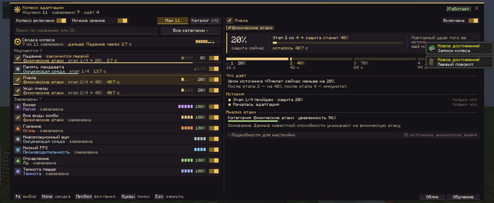 Подробности: защита сейчас, дорожка этапов, что даёт, история, решение анализатора | 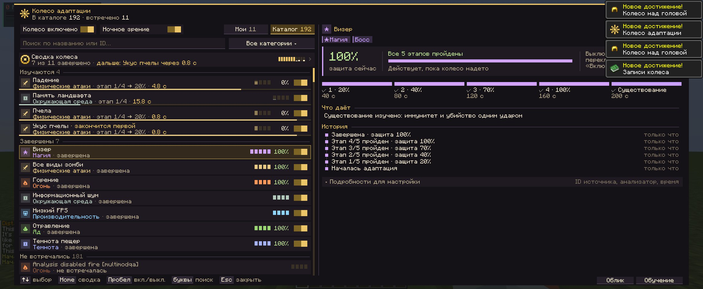 Босс после этапа V: иммунитет и убийство одним ударом |
| 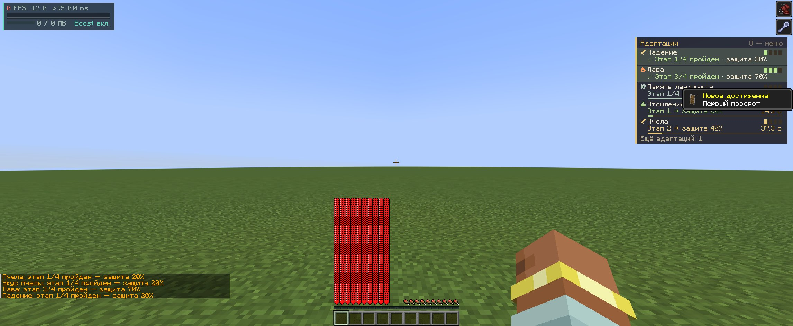 HUD под значками эффектов; пройденный этап подсвечивается | 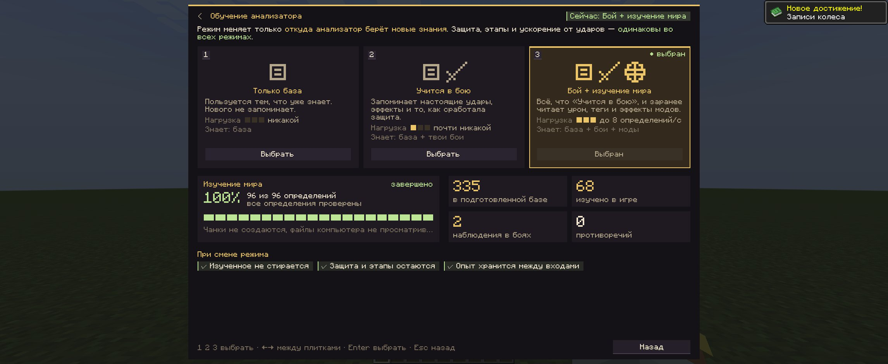 Экран «Обучение»: три режима, изучение мира, счётчики знаний |
| 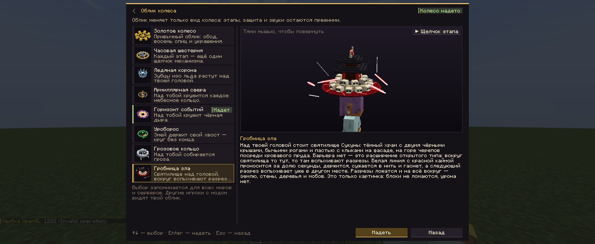 Экран «Облик колеса» с живым предпросмотром | 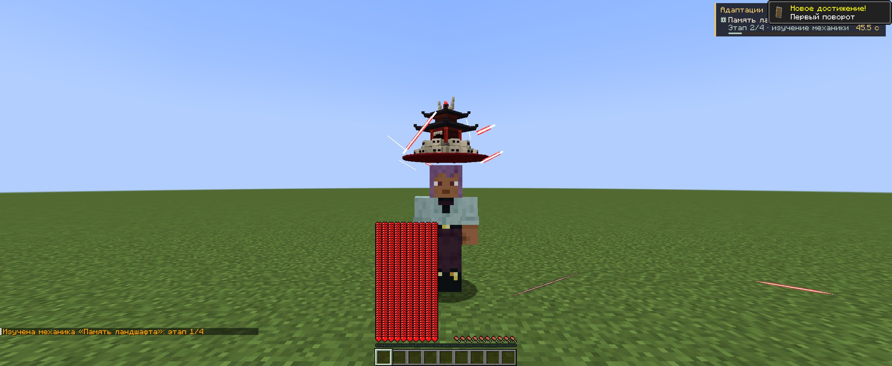 Облик «Гробница зла»: вокруг вспыхивают разрезы |
| 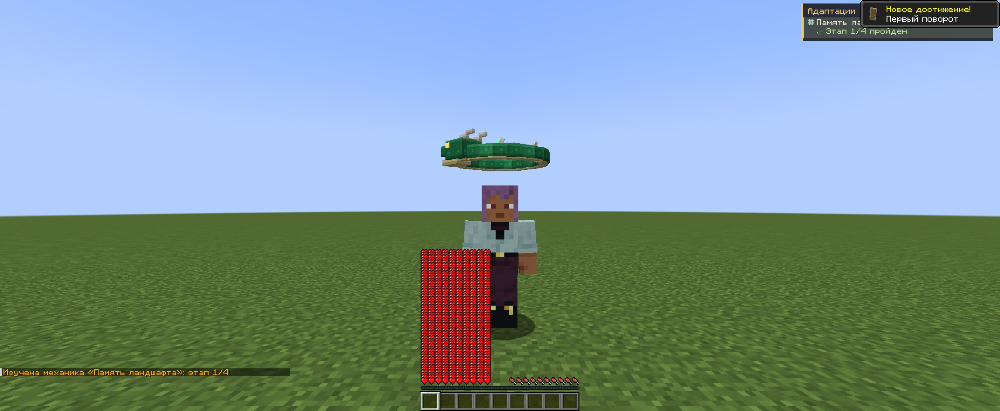 Облик «Уроборос» | 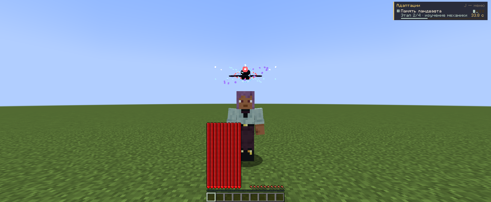 Облик «Безграничная пустота»: чёрное ядро и звёздная пыль |

### Лицензия и благодарности

- Код, данные, модели и тексты колеса — **MIT** ([LICENSE](LICENSE)).
- **Adapt Boost 1.7.0** — MIT; два класса, выведенных из ModernFix, под LGPL-3.0-or-later, память на основе FerriteCore под MIT; идеи — particle_core, Clumps, Dynamic FPS, ImmediatelyFast, Embeddium, Sodium, Lithium, MoreCulling.
- Полный список, хеши и ссылки на исходники — [THIRD-PARTY.md](THIRD-PARTY.md). Облики «Гробница зла» и «Безграничная пустота» — собственные модели, названия отсылают к «Магической битве»; чужих материалов нет.
- Автор мода — Pasha.

## Возможности

- **Колесо и этапы** — своя шкала для каждого вида моба, атаки, эффекта и условия; разновидности зомби
  объединены. Удар меняет скорость отсчёта, а не оставшееся время.
- **Меню J** — открывается на «Сводке колеса» (с 4.37.0: колесо с метками, что дальше, защита по категориям, слабые места, лента «Недавно»); каталог всех адаптаций текущей сборки по категориям, поиск, подробности с анализом и историей; в широком
  окне список и подробности стоят рядом, в низком — компактный заголовок.
- **Локальный анализатор и обучение** — категория и время незнакомых атак из модов по реестрам, тегам и
  наблюдениям, без интернета и языковой модели; режимы «Только база», «Учится в бою» и «Бой + изучение мира» —
  с 4.36.0 три плитки со значками показывают, откуда режим берёт знания, и нагрузку, а панель «Изучение мира» — сколько осталось (клавиши 1/2/3).
- **Меч истребления** — 10 HP, ×2 по нежити, ×4 по выбранным мобам (каждому можно задать свой множитель),
  парирование, отражение снарядов и Мировой разрез.
- **Вредные эффекты, голод, холод, темнота** — эффекты короче на каждом этапе и блокируются при 100 %, сытость
  держится полной, свет вокруг и бесконечное ночное зрение.
- **Небоевые адаптации** — граница мира, шум уведомлений, переполненный инвентарь (стопки без предела),
  тишина, нехватка памяти (на IV этапе — дальность прорисовки ниже на 2 чанка за раз, не меньше 6, и обратно
  после 30 спокойных секунд), низкий TPS, события вне игры (ошибки в логе, правка
  настроек, потеря сети…), промахи (наведение стрел и пуль), 23 бытовые (сон, порталы, печи, наковальня, колчан,
  торговля, батарея ноутбука…) и 2 для путешествий (трезубец, Око Края). Каждая выключается отдельно.
- **Низкий FPS и Adapt Boost** — после IV этапа включается встроенный оптимизатор (F8), с OptiFine и без него.
- **Совместимость** — 24 мода (Try 2 Survive, Jujutsu Craft v51, Ice and Fire, AoA3, Twilight Forest, First Aid,
  Alex's Caves и другие), общий перехват прямой записи HP и вредных эффектов модов, отдельные обработчики Tough
  As Nails, SanityDim, Mekanism, NuclearCraft, Dragon Survival и Mana and Artifice.
- **Достижения** — своя вкладка из 8 достижений и тихий зачёт прежнего прогресса при входе в мир.
- **Команды** — `/adaptation` для себя и для операторов.

## Подробно о механиках

### Предмет, степени и лечение

Крафт: 8 золотых слитков вокруг жемчуга Края. Предмет есть в творческом разделе инструментов; команда `/give @s adaptationwheel:wheel`.

ПКМ надевает колесо в слот головы и перемещает прежний шлем в руку. Через инвентарь его тоже можно надеть. Предмет не изнашивается и не добавляет обычные очки брони.

Первый пережитый урон запускает адаптацию. Защита по этапам по умолчанию: **20% → 40% → 70% → 100%**; её можно изменить в Configured. По умолчанию после каждого завершённого этапа игрок полностью лечится до своего текущего максимума здоровья; это лечение можно отключить в Configured. При завершении звучит присланный звук, колесо поворачивается один раз на 45°. Следующий этап начинается автоматически. На обычных этапах постоянного вращения нет. Во время пятого этапа «адаптация к существованию» колесо непрерывно вращается: один оборот за 4 секунды. Вращение сохраняет угол при синхронизации и останавливается при завершении, снятии колеса или отключении адаптации.

Разные воздействия имеют независимые шкалы. Все разновидности зомби объединены. Для остальных существ изучается их вид, поэтому иммунитет распространяется на всех представителей изученного вида.

### Отсчёт и ускорение

По умолчанию каждый повторный удар добавляет **30% базовой скорости текущего этапа**: ×1,00 → ×1,30 → ×1,60 → ×1,90 → ×2,20. Это сложение, не последовательное умножение.

С 4.48.0 HUD и меню показывают время **в секундах адаптации**, при ×1: удар не вычитает работу этапа и не меняет число, а ускоряет отсчёт. При ×1,00 одна секунда адаптации проходит за одну реальную секунду, при ×2,00 — за половину реальной секунды: 30 секунд адаптации при ×1,60 проходят за 18,75 реальной секунды, а меню показывает 30 с, которые убывают в 1,6 раза быстрее. Скорость видна золотым значком «×1.60» (в карточке «Сейчас» — «×1.60 · быстрее на 60%»), а после удара строка на 1,5 с показывает «+30% скорости». Опыт стихии (+5 % за каждый освоенный источник того же вида, до +35 %) прибавляется к этой скорости с самого начала этапа и времени этапов не меняет.

Скорость сбрасывается после каждого этапа. Контактные удары во время краткой неуязвимости Minecraft ускоряют уже запущенный этап. Один удар не считается повторно из-за нескольких событий Forge. Первый контакт без полученного урона не запускает шкалу.

Для сравнения: при оставшихся 30 секундах адаптации и неизменной скорости ×1,30 этап займёт примерно 23,1 реальной секунды, при ×2,20 — 13,65 с, при ×2,80 — 10,75 с. Значения учитывают шаг сервера 0,05 с при 20 TPS. Ограничения скорости на ×2,20 нет.

Длительное нахождение в холоде, темноте или под одним и тем же эффектом не добавляет бонус каждый тик. Новое наложение вредного эффекта считается новым воздействием. При низком TPS реальные секунды длиннее: прогресс рассчитывается серверными тиками.

### Полный каталог

Открой меню **J**, нажми вкладку «Каталог» (рядом с ней число записей), затем выбери категорию в списке «Все категории»: например, «Физические атаки». После выбора останутся только записи этой категории. «Все категории» снимает фильтр.

В каталоге есть отдельные существа, вредные эффекты и типы урона из реестров текущего сервера, включая установленные моды и пакеты данных. Голод, холод и темнота имеют свои записи. Варианты зомби и одинаковые источники голода/замерзания объединены.

Поиск работает по названию и идентификатору, например `examplemod:light_beam`. Нажатие на запись открывает подробности: тип, базовое время, защиту, прогресс и скорость. Ещё не встречавшиеся воздействия отмечены отдельно. Просмотр каталога не даёт иммунитет и не запускает адаптацию.

Во вкладке «Мои» видны изучаемые и изученные записи, по группам: «Изучаются», «Ждут удара», «Завершены», «Выключены»; в каталоге ниже ещё «Не встречались». Их можно отключать и включать отдельно. Новая обнаруженная атака появляется в списке автоматически.

### Время этапов

Это базовое время каждого этапа без ускорения.

| Категория | 1 | 2 | 3 | 4 |
| --- | --- | --- | --- | --- |
| Огонь | 8 с | 20 с | 32 с | 44 с |
| Физические атаки | 20 с | 50 с | 80 с | 110 с |
| Снаряды | 20 с | 50 с | 80 с | 110 с |
| Взрывы | 25 с | 55 с | 85 с | 115 с |
| Электричество | 25 с | 55 с | 85 с | 115 с |
| Свет | 32 с | 67 с | 102 с | 137 с |
| Магия и боссы | 40 с | 80 с | 120 с | 160 с |
| Вредные эффекты, яд, удушье | 12 с | 30 с | 48 с | 66 с |
| Голод, холод, темнота, прочая среда | 10 с | 25 с | 40 с | 55 с |

Босс определяется по фактическому максимальному здоровью: **100 HP и больше**. Его адаптация к виду имеет магическое время и пятый этап на 200 секунд. Отдельный огненный, световой или другой тип атаки сохраняет собственную категорию.

### Отрицательные эффекты, голод и холод

Поддерживаются все зарегистрированные эффекты категории HARMFUL, включая эффекты модов. Зловещее знамение и контурное свечение Minecraft тоже считаются отрицательными. Положительные эффекты не запускают адаптацию.

Промежуточная степень сокращает оставшуюся длительность конечного отрицательного эффекта на 20%, 40% или 70% при новом наложении и завершении этапа. На 100% эффект снимается, новое наложение блокируется. Мгновенный урон уменьшается через события урона.

Голод от гнилой плоти, низкая сытость (6 или меньше) и урон от голодания относятся к одной адаптации. На 100% она поддерживает еду и насыщение на 20, убирает истощение и эффект голода. Можно бегать, прыгать и пользоваться обычной регенерацией без еды. Отключение адаптации возвращает обычный расход еды.

Холод начинается при обморожении. На 100% обморожение сбрасывается и урон от замерзания блокируется.

### Темнота и бесконечное ночное зрение

Темнота изучается в тёмной пещере без внешнего света. На свету её прогресс стоит на паузе.

| Степень | Результат |
| --- | --- |
| 1 | Освещение вокруг игрока уровня 5 |
| 2 | Освещение уровня 10 |
| 3 | Освещение уровня 15, ярче факела |
| 4 | Уровень 15 и бесконечное ночное зрение |

Кнопка ночного зрения появляется в меню **только после четвёртой степени темноты**. Бонус имеет настоящую бесконечную длительность, не входит в окно мерцания и не обновляется короткими порциями. Настройка сохраняется после выхода и смерти. Выключение ночного зрения сохраняет освещение.

Внешнее зелье ночного зрения сохраняется отдельно с обычным расходом его времени. Если выключить бонус или снять колесо, оставшийся эффект зелья восстановится. Истёкшее зелье не возвращается. Молоко очищает внешний эффект; включённая полная адаптация затем возвращает свой бонус.

Освещение настоящее и движется вместе с игроком. Оно размещает временный невидимый источник в свободном воздухе, очищает его при перемещении, снятии колеса, смерти и выходе. Собственный свет не мешает изучать темноту. Сплошные стены препятствуют влиянию внешнего факела на определение темноты. После перезапуска оставшийся источник удаляется запланированным тиком.

### Поддержка модов и локальный анализатор

Анализатор работает внутри мода, без интернета, внешнего сервиса или языковой модели. Он анализирует реестры Forge, теги типов урона, идентификатор атаки, messageId, категорию эффекта и здоровье источника.

Пример: мод регистрирует `examplemod:light_beam` и наносит им урон. Анализатор распознаёт свет, создаёт индивидуальную адаптацию к этому лучу и начинает её после полученного урона. Если источник — существо, параллельно может изучаться его вид. Применяется сильнейшая из подходящих защит; проценты не складываются.

Приоритет классификации:

1. Явный тег категории адаптации.
2. Стандартные теги огня, взрывов, молний, замерзания, утопления и падения.
3. Значимые части имени типа урона и messageId: light/laser/radiant, poison/venom/toxic, magic/arcane/spell и другие.
4. Тег снаряда или источник Projectile.
5. «Окружающая среда» для неизвестного воздействия. Оно всё равно получает отдельную адаптацию по своему идентификатору.

Для непрозрачного названия автор мода или пакета данных может задать точную категорию без изменения Java-кода. Например, файл `data/adaptationwheel/tags/damage_type/adaptation/light.json`:

```json
{
  "replace": false,
  "values": ["examplemod:opaque_attack"]
}
```

Доступные имена тегов: `fire`, `physical`, `magic`, `effect`, `hunger`, `cold`, `darkness`, `environment`, `projectile`, `explosion`, `light`, `electric`, `poison`, `suffocation`. Реестры пакетов данных проверяются при обновлении каталога.

Это автоматический анализ правил игры, а не гарантированное понимание любого кода. Нестандартный мод, который напрямую меняет здоровье или собственные свойства, обходя стандартные события урона/эффектов Forge, может требовать отдельной интеграции. Положительный эффект, ошибочно объявленный его автором как HARMFUL, будет обрабатываться согласно этому объявлению.

Если атака использует незарегистрированный Direct Holder, анализатор создаёт запись по её messageId. Одинаковые неуникальные messageId не позволяют точно различить такие атаки; зарегистрированный тип с идентификатором своего мода обеспечивает точное разделение.

### Адаптация к существованию

На четвёртой степени действует настроенный процент защиты (по умолчанию 100%). Если адаптация к существованию включена, после пятой степени действует полная защита. При включённом отдельном переключателе убийства босса можно победить одним ударом, даже кулаком. Поддерживаются Варден, Дракон Края, Иссушитель и подходящие существа модов. У дракона учитываются части тела и обычная анимация смерти.

Заблокированные атаки уже изученного босса ускоряют пятый этап. Ровно 100 HP его открывает, 99 HP — нет. Пустота, /kill и служебный урон с тегом BYPASSES_INVULNERABILITY сохраняют обычное действие. Первый смертельный урон не запускает адаптацию.

### Настройка времени через Configured

Установи Configured 2.2.3 для Forge 1.20.1 вместе с этим модом. Зайди в мир и открой список модов → **Adaptation Wheel → настройки → серверная конфигурация**. Для настроек вне мира выбери нужный мир, если Configured предлагает его список.

- **Время по категориям**: отдельно задаются секунды для каждого из четырёх этапов и пятого этапа босса.
- **Время отдельных мобов (0 = из категории) → Все виды зомби → Этап 1**: поставь **5**, чтобы первый этап против зомби занимал 5 секунд при ×1,00. Остальные этапы меняются своими полями. Настройка общая для зомби, кадавров, утопленников и остальных объединённых вариантов.
- Есть отдельные разделы для скелета, паука, крипера, эндермена, ведьмы, ифрита, Вардена, Дракона Края и Исушителя.
- В полях отдельных мобов **0** означает «использовать время категории». Для категорий допустимо от **1 до 86400 секунд**. Пятый этап действует только для мобов с максимальным здоровьем 100 HP и больше.

Нажми кнопку сохранения в Configured. Меняется фактическое время завершения на сервере, а не только текст шкалы. Изменения применяются без перезапуска мира; шкалы и каталог получают актуальные значения от сервера. Уже полученные степени сохраняются, прошедшее время текущего этапа не стирается. Если оно уже превышает новую длительность, этап завершится при следующем тике. Выбранное ускорение за удар (по умолчанию +30%) продолжает действовать поверх выбранного времени.

Конфигурация конкретного мира: `serverconfig/adaptationwheel-server.toml`. На сервере для всех игроков действуют настройки администратора; собственные локальные значения игрока их не подменяют. Configured нужен для графического редактора, сам мод работает и с редактированием TOML вручную.

Для любого другого моба, атаки или отрицательного эффекта добавь строку в **«Время других источников: список правил» / sourceOverrides**:

```text
mob:examplemod:creature=5,10,15,20,25
damage:examplemod:light_beam=2,4,6,8,10
effect:minecraft:poison=3,6,9,12,15
```

Пять чисел — секунды пяти этапов. `0` наследует соответствующий этап категории. Эти точные правила приоритетнее обычных полей моба. Идентификаторы адаптаций видны в каталоге J. Без правил и отдельных переопределений сохраняются прежние значения времени.

## Сборка и проверки

Требуется JDK 17. Gradle Wrapper включён.
`build-mod.ps1` берёт JDK из `.tools\java`, если он там есть, и кеш Gradle из `.gradle-user-home`; `--offline` в
списке задач собирает без сети.

GameTest запускается отдельно от сборки jar и без встроенного Adapt Boost: jar, собранный в одном запуске
с `runGameTestServer`, выходит без него и не загружается в настоящей игре.

```powershell
Remove-Item build\resources\main\META-INF\jarjar\*.jar -ErrorAction SilentlyContinue
.\build-mod.ps1 -Tasks 'runGameTestServer','--offline'
.\build-mod.ps1 -Tasks 'build','--offline'
```

Результат находится в `build/libs`. Тестовые существа/эффекты/типы урона и классы GameTest исключены из выпускаемого JAR.

Выпуск собирает `release-4.51.0.ps1`: четыре варианта (`trained`, `untrained` и оба с `-online`), каждый чистой
сборкой с модульными тестами; затем проверяет, что встроенный Adapt Boost 1.7.0
побайтово не изменился, и кладёт jar, исходники и `SHA256SUMS` в `dist/`.

Проверки покрывают таймер сервера и интерфейса, ускорение контактов, независимые стадии, лечение, паузы, сохранение категории, босса и дракона, вредные/полезные эффекты, сытость, холод, пещерный свет, бесконечное ночное зрение, сохранение внешних зелий и владения после перезапуска, новые атаки из мода, классификацию по тегам и полный каталог.

В 4.51.0 удалена «Память собственного поражения». Итоги проверки приведены в [VALIDATION-4.51.0.md](VALIDATION-4.51.0.md).
Результаты 4.48.1 (`VALIDATION-4.48.1.md`): выпуск только упаковки — в jar теперь лицензия MIT, `mods.toml` с MIT и ссылками на GitHub, новый `THIRD-PARTY.md`; код игры, протокол 22 и встроенные Adapt Boost 1.7.0 и Distant Horizons 3.3.3 не изменились, `coreTest` во всех четырёх вариантах, **GameTests 191/191**; в jar проверены `META-INF/LICENSE`, `META-INF/THIRD-PARTY.md` и MIT в `mods.toml`.
Результаты 4.48.0 (`VALIDATION-4.48.0.md`): время в меню и HUD — в секундах адаптации (×1), скорость от ударов видна золотым значком «×1.30», после удара — «+30% скорости»; опыт стихии стал скоростью, а не короче этапами; `coreTest` во всех четырёх вариантах (новые проверки скорости и вспышки удара), **GameTests 191/191**; в живом клиенте меню и HUD не снимались. Протокол поднят до 22.
Результаты 4.47.0 (`VALIDATION-4.47.0.md`): в окне «Обучение» объяснено, что такое определения (строка под числом и подсказка у «?»);
`LearningLayoutTest` и `coreTest` во всех четырёх вариантах, **GameTests 191/191**; в живом клиенте окно не снималось.
Результаты 4.46.0 (`VALIDATION-4.46.0.md`): облик «Безграничная пустота» меняет мир вокруг — поток знаков над мобами, звёздная пыль, синий и красный круги (у каждой части свой переключатель); `VoidWorldPlanTest` и
`coreTest` во всех четырёх вариантах, **GameTests 191/191**; в живом клиенте эффекты не снимались.
Результаты 4.45.2 (`VALIDATION-4.45.2.md`): облики колеса и разрезы Храма злобы проверены на 17 шейдер-паках — без чёрных полос (LUMA), белого пятна (Chocapic) и полос к небу (Builders), у всех PASS;
`coreTest` во всех четырёх вариантах, **GameTests 191/191**.
Результаты 4.45.0 (`VALIDATION-4.45.0.md`): таблица урона для 616 модов (428 типов) и строка «Откуда знание» в меню J;
`coreTest` во всех четырёх вариантах, **GameTests 191/191**; в живом клиенте строка «Откуда знание» не снималась.
Результаты 4.44.0 (`VALIDATION-4.44.0.md`): ручная поправка категории в меню J;
`coreTest` во всех четырёх вариантах, **GameTests 191/191**, 9 мутаций из 9 пойманы, настоящий клиент на копии игры: `screens-wide`, `screens-compact`, `screens-optifine` — PASS.
Результаты 4.43.0 (`VALIDATION-4.43.0.md`): одна адаптация на удар, безымянный урон по модам, мягкие аналогии, опыт стихии и `/adaptation why`;
`coreTest` во всех четырёх вариантах, **GameTests 190/190**, 17 мутаций из 17 пойманы, настоящий клиент на копии игры: `analyzer-pasha` — PASS.
Результаты 4.42.0 (`VALIDATION-4.42.0.md`): анализатор без лимитов, взрывы гаста и крипера учат «Взрывы»;
`coreTest` во всех четырёх вариантах, **GameTests 180/180**, 13 мутаций из 13 пойманы, настоящий клиент на копии игры: `analyzer-pasha` — PASS.
Результаты 4.41.0 (`VALIDATION-4.41.0.md`): клинки «Гробницы зла» по дизайну malevolent-shrine-2026-11-01 (ревизия 3, модель m17-r3);
`coreTest` во всех четырёх вариантах (`SkinRigTest`, `ShrineCutPlanTest`), **GameTests 174/174**, настоящий клиент на копии игры: с OptiFine и без него —
PASS, снимки просмотрены; заметной цены разрезов в кадре нет (разброс между прогонами больше эффекта).
Результаты 4.40.0 (`VALIDATION-4.40.0.md`): адаптация к тексту «Безграничной пустоты» и красный поток по дизайну
void-text-adaptation-2026-11-03 (ревизия 2); `coreTest` во всех четырёх вариантах (новый `VoidTextTest`, модель m18-r2, меню облика
на 17 633 размерах GUI), **GameTests 174/174**, настоящий клиент на копии игры: 1146×472, 462×265 и с OptiFine и Configured — PASS.
Результаты 4.38.0 (`VALIDATION-4.38.0.md`): облик «Гробница зла» по дизайну malevolent-shrine-2026-11-01 (ревизия 2);
`coreTest` во всех четырёх вариантах (вспышки разрезов m17-r2, `ShrineCutPlanTest`, меню облика на 8 карточек на 17 633 размерах GUI),
**GameTests 171/171**, выпускной jar в настоящем клиенте с OptiFine и Configured: 8 обликов, разрезы на земле и на корове,
настройка «Разрезы вокруг» выключает их — PASS.
Результаты 4.37.0 (`VALIDATION-4.37.0.md`): сводка колеса в меню J по дизайну ui-five-variants-2026-10-31 (ревизия 3);
`coreTest` во всех четырёх вариантах (новый `WheelSummaryTest`), **GameTests 171/171**,
выпускной jar в настоящем клиенте: меню J со сводкой в окне 1146×472 и в окне лаунчера 462×265 — PASS.
Результаты 4.36.0 (`VALIDATION-4.36.0.md`): плитки режимов обучения по дизайну learning-ui-variants-2026-10-31 (вариант C);
`coreTest` во всех четырёх вариантах (`LearningLayoutTest` на 17 633 размерах GUI, время «осталось», склонения), **GameTests 171/171**,
выпускной jar в настоящем клиенте: экран обучения в окне 1146×472 и в окне лаунчера 462×265 — PASS.
Результаты 4.35.0 (`VALIDATION-4.35.0.md`): «Понятные режимы обучения» по дизайну learning-modes-2026-10-31;
`coreTest` во всех четырёх вариантах (новый `LearningLayoutTest` на 17 633 размерах GUI), **GameTests 171/171**,
выпускной jar в настоящем клиенте: экран обучения в окне 1146×472 и в окне лаунчера 462×265 — PASS.
Результаты 4.34.0 (`VALIDATION-4.34.0.md`): «Интерфейс понятнее» по дизайну ui-clarity-2026-10-30; `coreTest` во всех четырёх вариантах (новый `UiClarityTest`),
**GameTests 171/171**, выпускной jar в настоящем клиенте: окно 1146×472 и окно лаунчера 462×265 — PASS, по 12 снимков.
Результаты 4.33.3 (`VALIDATION-4.33.3.md`): «Армиллярная сфера» — модель m16, видно, как крутится каждое кольцо
(сегменты двух цветов, кольца быстрее); `coreTest` во всех четырёх вариантах (новая проверка двухцветных колец),
**GameTests 171/171**, выпускной jar в настоящем клиенте с OptiFine и Configured — PASS, 50 проверок.
Результаты 4.33.2 (`VALIDATION-4.33.2.md`): «Армиллярная сфера» — модель m15, вращаются все круги;
`coreTest` во всех четырёх вариантах (6 обликов, 665 коробок, новая проверка вращения кругов), **GameTests 171/171**,
выпускной jar в настоящем клиенте с OptiFine и Configured — PASS, 50 проверок.
Результаты 4.33.1 (`VALIDATION-4.33.1.md`): «Горизонт событий» — модель m10-r2 без луча; `coreTest` во всех
четырёх вариантах (6 обликов, 665 коробок), **GameTests 171/171**, выпускной jar в настоящем клиенте с OptiFine и
Configured — PASS, 50 проверок. Результаты 4.33.0 (`VALIDATION-4.33.0.md`): модульные тесты `coreTest` (входят в `check`, в том числе
модели обликов и раскладка экрана облика на 17 633 размерах GUI) прошли во всех четырёх вариантах, **GameTests
171/171** (2 из них — для облика). Экран облика проверен настоящим клиентом (пробный мод `Skins433Qa`): окно
1146×472, окно лаунчера 462×265 и OptiFine I6_pre6 + Configured 2.2.3 — все три прогона PASS. Прежняя проверка в
настоящем клиенте (4.32.0, `VALIDATION-4.32.0.md`): достижения без модов и с полным набором Паши (87 jar), 47 шагов,
оба прогона PASS.


## Девять обликов колеса

| | | |
| --- | --- | --- |
| 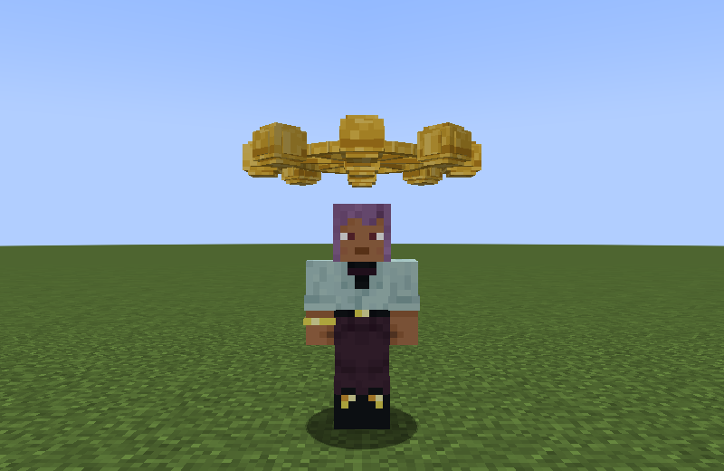<br>Golden Wheel | 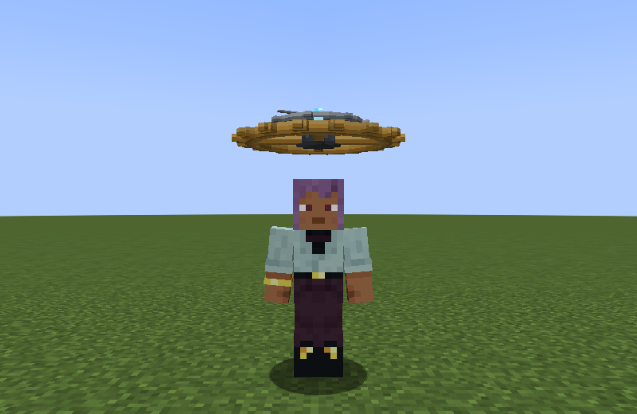<br>Clockwork Gear | 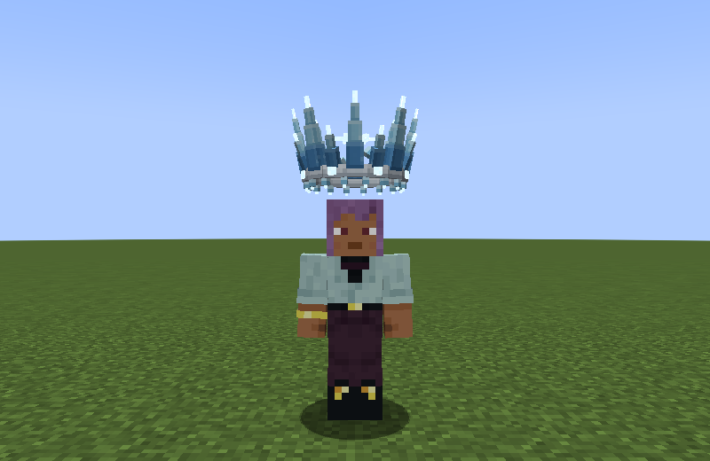<br>Ice Crown |
| 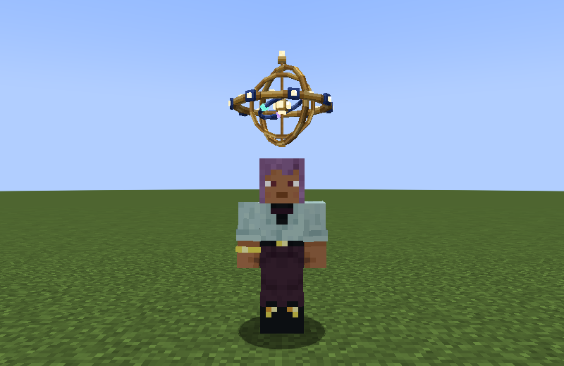<br>Armillary Sphere | 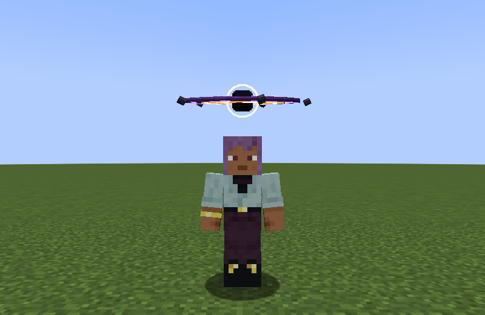<br>Event Horizon | 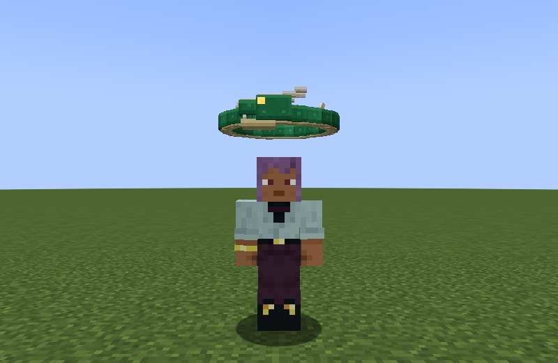<br>Ouroboros |
| 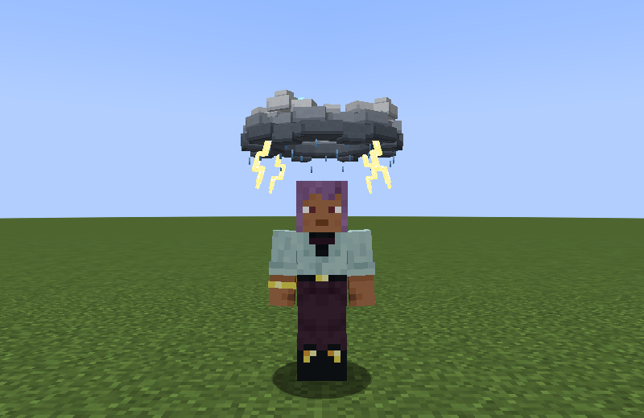<br>Storm Ring | 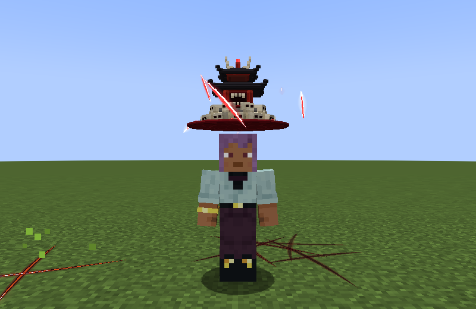<br>Malevolent Shrine | 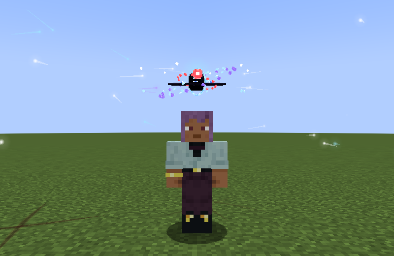<br>Infinite Void |
